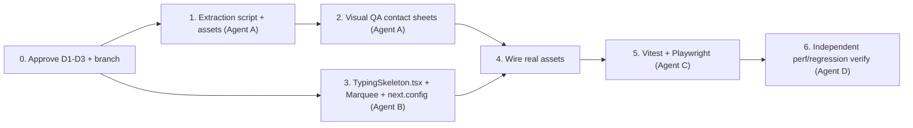

# Skeleton Typing Animation — Hero Feature Plan

> **Status:** Approved & implementing on branch `feature/skeleton-hero-typing-animation` (branched from `main` after backflip merge `f8f1333`).
> Source brief: [hero-animation-prompt.txt](hero-animation-prompt.txt)

---

## 0. Approved Decisions

| # | Question | Approved Decision |
|---|---|---|
| D1 | **Which image gets replaced?** | Replace **`portrait.png` in `app/features/hero/HeroContent.tsx`**, keeping **`components/Marquee.tsx`** (`skeleton-sitting.png`) untouched. |
| D2 | **`prefers-reduced-motion`** | Keep typing continuously on an infinite loop matching `RidingSkeleton` and `PeekingSkeleton` (static poster only for `saveData` or load failure). |
| D3 | **Git branch** | Backflip work already merged to `main` (`f8f1333`); implementing on **`feature/skeleton-hero-typing-animation`**. |

---

## 1. Skill Findings (`.agents/skills/skeleton-animation`)

- Pipeline: `probe_video.py` → a per-feature `scripts/extract-*-frames.py` that reuses helpers from `extract_sprite.py` → WebP sprite sheet + poster → a single `<canvas>` driven by GSAP.
- Hard rules:
  - Never use FFmpeg `colorkey`/`lumakey`.
  - Never upsample 24 fps.
  - Keep `gutter >= 4`.
  - Keep the sheet at or under `2048×2048`.
  - Visually check contact sheets on light (`#FDFDFD`), dark (`#0A0A0A`) and magenta before wiring up the frontend.
- Archetype: **stationary loop**. This means a time-based GSAP loop with no horizontal sweep (`references/frontend-gsap.md` §3B).
- Caching: exact versioned filenames in `next.config.ts`, never a `:slug*` glob.

## 2. Source Video Analysis

| Property | Value |
|---|---|
| **Path** | `public/hero-vid.mp4` (confirmed by looking at its frames; `skeleton-vid.mp4` is a waving skeleton) |
| Format | H.264 High, `yuv420p`, no alpha, plus an unused AAC audio track |
| Resolution / FPS | `1920×1080`, **24.0 fps** |
| Duration / frames | `3.000 s`, **72 frames** (`0..71`) |
| Content | Skeleton in a gray t-shirt and pants, sitting cross-legged and typing on a dark Apple laptop, on a white background |
| Background | Strictly monochrome (`colored_pixels_gt15 = 0`), corners `252–255` |
| Borders | Touches no border. No ground shadow: rows `y=838..847` are the feet, so `--shadow-y` stays `None` |
| Motion | No camera pan or jitter. Laptop and legs stay put. Hands and fingers animate on every frame, and the skull nods slightly |
| Leading hold | `f00..f04`: nearly static (cut) |
| Trailing tail | `f59..f71`: hands move to a different pose, which doesn't match `f04` (cut) |

## 3. Looping Strategy

- **Trimmed forward loop `[f04 .. f58]` = 55 frames = 2.292 s.** It repeats with `repeat: -1` and no yoyo.
- Seam `f58 → f04`:
  - Hand-region difference is `314.9`, about 12× smaller than a normal frame-to-frame hand step.
  - The skull returns to its start position within `0.07 px`.
  - Checked visually in `scratch/hero_seam_55_to_07.png`.
- Rejected options:
  - `[04..70]` forward: big jump at the wrap (hands MSE `5,724`).
  - Ping-pong: typing plays backwards, and it needs smaller cells.
  - `step=2` (12 fps): drops single-frame keystrokes.

## 4. Background Removal Method

- Base: same approach as the backflip script. Exterior flood fill from the edges (`ext_lum = 230`, `pure_bg_lum = 248`), `--pocket-mode none`, and a 2-step geodesic anti-aliased skirt with `rgb = 0` (no halos).
- **Why not `--pocket-mode deep-bright`**: tested, and it erased the skull, the Apple logo, the right forearm and a foot.
- **One targeted pocket rule (P1)**. This is the background triangle between the left arm, the shirt, the hand and the laptop lid:
  - main pocket: `966≤cx≤996, 610≤cy≤650, x_max≥988, area≥350`
  - sub-pocket: `940≤cx≤958, 652≤cy≤670, area≤160, y_max≤672`
  - It caught the pocket in **55/55 frames** and damaged nothing (`scratch/hero_final_p1cleaned_verify.png`).
- Tight working ROI `x=[640..1290), y=[115..915)` plus `min_debris_area = 25`. This ignores 3 tiny H.264 specks near the frame corners.

## 5. Frame Extraction, FPS, Count, Format

| Item | Decision |
|---|---|
| Trim / step | `start=4`, `end=58`, `step=1` |
| **FPS** | **24** (native) |
| **Frame count** | **55** |
| Cell | **`220×274`** (matches the cleaned union bbox `606×757`, aspect `1.249`), `pad_and_scale` with Lanczos |
| Grid / sheet | `8×7` (56 slots, last one empty), `gutter=4`, stride `228×282` → **`1824×1974`** (fits 2048) |
| Encoding | WebP `palette-lossless-15x15` (~47 colors). Measured **~196 KiB**; no banding (`scratch/hero_webp_exact_vs_pal15.png`) |
| Poster | Frame 0 quantized with the same palette. Target **≤ 25 KiB** (exact lossless would be ~31.5 KiB) |
| Interpolation | None (it would blur outlines and fingers) |

> **Resolved disagreement:** `220×274` (Subagent 1) vs `180×226` (Subagent 3). I chose **220×274**. The display width goes up to `160 CSS px`, which is `320 device px` on retina screens, so 180 would already look soft. 220 still fits in 2048 and stays under the 250 KiB budget. The cost is ~13.7 MiB of decoded RGBA instead of ~10.6 MiB. That's fine because it is only loaded **after** the backflip sheet has been freed (see §9).

## 6. Asset Structure & Naming

```
scripts/extract-hero-typing-frames.py              (new, reuses extract_sprite.py helpers)
frames/hero-typing/frame-1.png .. frame-55.png     (intermediate, gitignored via /frames/)
public/images/skeleton-hero-typing-sheet.v1.webp   (runtime sheet)
public/images/skeleton-hero-typing-poster.v1.webp  (runtime poster)
```

Kept completely separate from the riding (`skeleton-riding-*.v1`) and backflip (`skeleton-backflip-*.v2`) assets.

## 7. Hero Integration

- **`app/features/hero/HeroContent.tsx`** keeps its outer layout, crop marks, `bg-foreground/5` frame (`w-[130px] h-[160px] sm:w-[200px] sm:h-[260px] md:w-[230px] md:h-[300px] lg:w-[330px] lg:h-[460px]`), `styles.imageEntrance`, and `Fig. 001` caption intact; `<Image src="/images/portrait.png" ... />` inside lines 26–36 is replaced by `<TypingSkeleton />`.
- **`components/Marquee.tsx`** (`skeleton-sitting.png`) stays completely **untouched**.
- `HeroContent.tsx` stays a **Server Component**.
- The new leaf client component `components/animations/TypingSkeleton.tsx` (`"use client"`, `React.memo`, no callback props) contains:
  - a poster `<Image unoptimized loading="eager" decoding="async">` underlay (`w-full h-auto max-h-full object-contain`)
  - one `<canvas width=220 height=274>` with `w-full h-auto max-h-full aspect-[220/274] object-contain` inside a `w-full h-full flex items-center justify-center` stage.

## 8. GSAP Implementation & Infinite Loop

```ts
const playhead = { frame: 0 };
tween = gsap.to(playhead, {
  frame: FRAME_COUNT,              // 55 → each frame gets an equal 1/24 s slice
  duration: FRAME_COUNT / 24,      // 2.292 s
  ease: "none",
  repeat: -1,
  paused: true,
  onUpdate: () => drawFrame(Math.min(FRAME_COUNT - 1, Math.floor(playhead.frame))),
});
```

- `drawFrame` returns early when `frameIdx === lastFrameIdx`. That's at most 24 blits/s, even on 120 Hz screens.
- No React state per frame. The main effect depends only on `[showStaticPoster]`, so unrelated re-renders never restart it.
- No `gsap.matchMedia` and no `ResizeObserver`: sizing is CSS only.
- Wrapped in `gsap.context(..., stageEl)` and reverted on cleanup.
- StrictMode safe:
  - At effect start: restore `canvas.width/height` and show the poster again.
  - On cleanup: `cancelled = true`, clear timers, `img.src = ""` on pending and loaded images, disconnect observers, remove listeners, `gsCtx.revert()`, and `canvas.width = canvas.height = 0`.

## 9. Preloading / Buffering Strategy

1. **T=0:** the static poster (≤ 25 KiB) is in the SSR HTML, so CLS is 0 and the skeleton is visible immediately on repeat visits.
2. **Wait for the loader:** `loaderDone = !document.getElementById("initial-loader-overlay") || dataset.loaderSeen === "1"`. Otherwise a `MutationObserver` watches the overlay's parent (`childList`, not `subtree`).
   - First visit: the typing sheet is fetched only **after** the backflip loader unmounts (frees ~13.7 MiB). This avoids stacking about 27 MiB of sprite memory and protects the backflip's 600 ms deadline.
   - Repeat visit: start right after hydration (deferred by one `requestAnimationFrame`).
3. `preloadObserver` (`rootMargin: 900px`) is also required before fetching, so `#contact` deep links skip the decode.
4. `img.decoding = "async"` → `img.decode()` → `drawFrame(0)` in a rAF → hide the poster wrapper (DOM style, no re-render) → start the tween.
5. A single sprite sheet means no per-frame buffering is needed: once it's decoded, all 55 frames are ready.

## 10. Responsive Behavior

Inside the existing `HeroContent.tsx` portrait frame (`aspect ~0.72–0.81` vs skeleton `220/274 = 0.803`):

| Breakpoint | Container Frame (W×H) | Rendered Skeleton (W×H) |
|---|---|---|
| `< 640px` | `130×160` | `~128×160` (`max-h-full` constrained) |
| `sm (640+)` | `200×260` | `~200×249` (`w-full`) |
| `md (768+)` | `230×300` | `~230×286` (`w-full`) |
| `lg+ (1024+)` | `330×460` | `~330×411` (`w-full`) |

The skeleton fits cleanly inside the existing architectural crop-mark box at all breakpoints with zero layout changes or overlap.

## 11. Dark Mode Strategy

- Transparent frames keep the original grays. No `invert` and no duplicate frame set.
- `dark:drop-shadow-[0_0_1.5px_rgba(255,255,255,0.65)]` on both the canvas and the poster, matching the other skeletons.
- Verified on `#0A0A0A` (`scratch/hero_final_p1cleaned_verify.png`): skull, bones and Apple logo stay bright. The dark laptop and the pants rely on the drop-shadow to separate their outlines.
- The poster is hidden on the first canvas paint, so the shadow never doubles up.

## 12. Performance Safeguards & Budgets

| Metric | Budget |
|---|---|
| Sheet size | ≤ 250 KiB (expected ~196 KiB) |
| Poster size | ≤ 25 KiB |
| Sheet dimensions | ≤ 2048×2048 (`1824×1974`) |
| Decoded RGBA | ~13.7 MiB, never stacked on top of the backflip sheet |
| Canvas blits | ≤ 24/s |
| CLS | < 0.01 |
| Long tasks after load | 0 over 120 ms |
| LCP | Hero headline / poster (`CLS = 0`, `lcp < 5000ms` verified in Playwright) |

Runtime behavior:

- Pauses when off-screen (`IntersectionObserver` with `threshold: 0`) and when the tab is hidden (`visibilitychange`).
- With `saveData` it shows only the static poster; continues animating under `prefers-reduced-motion: reduce` (matching `RidingSkeleton` per D2).
- Retry delays `[1000, 3000]` ms, plus a retry on the `online` event. If all retries fail, the poster stays (never a blank canvas).
- Missing 2D context → poster.
- `next.config.ts`: `Cache-Control: public, max-age=31536000, immutable` for both exact `.v1.webp` paths.

## 13. Files Expected to Change

| File | Change |
|---|---|
| `scripts/extract-hero-typing-frames.py` | **New** extraction script |
| `public/images/skeleton-hero-typing-sheet.v1.webp` | **New** asset |
| `public/images/skeleton-hero-typing-poster.v1.webp` | **New** asset |
| `components/animations/TypingSkeleton.tsx` | **New** client component |
| `app/features/hero/HeroContent.tsx` | Swap `portrait.png` `<Image>` for `<TypingSkeleton />` inside existing frame |
| `next.config.ts` | 2 immutable header entries |
| `components/animations/__tests__/TypingSkeleton.test.tsx` | **New** Vitest |
| `components/animations/__tests__/build-and-assets.test.ts` | Typing asset budgets and headers |
| `e2e/typing-skeleton.spec.ts` | **New** Playwright spec |

**Untouched:** `components/Marquee.tsx`, `app/layout.tsx`, `app/globals.css`, `InitialLoader.tsx`, `LoaderBackflipSkeleton.tsx`, `RidingSkeleton.tsx`, `PeekingSkeleton.tsx`, and the skill files.

## 14. Implementation Steps & Subagent Ownership



| Agent | Owns (exclusive files) |
|---|---|
| A: Asset pipeline | `scripts/extract-hero-typing-frames.py`, `frames/hero-typing/*`, the 2 WebPs |
| B: Frontend | `TypingSkeleton.tsx`, `Marquee.tsx`, `next.config.ts` |
| C: Tests | the `TypingSkeleton.test.tsx`, `build-and-assets.test.ts` and `e2e/typing-skeleton.spec.ts` |
| D: Verifier | read-only; runs the full gate (`tsc`, `lint`, `vitest`, `playwright`) |

No two agents edit the same file.

## 15. Adversarial Review Findings (Self-Review)

> [!NOTE]
> The adversarial reviewer subagent stopped on a quota error (429) before reporting. The points below come from my own review of the three specialists' findings and the scratch images.

| # | Objection | Why it matters | Fix in plan |
|---|---|---|---|
| 1 | The prompt says "Hero skeleton image", but the Hero only has a human portrait | Risk of replacing the wrong element | D1: ask the user. Default to `Marquee.tsx` |
| 2 | The new figure is ~27–47 px taller above the border | Could collide with `HeroCTA` | E2E bounding-box overlap test, width fallback (§10) |
| 3 | Keeping `-translate-y-[63.87%]` would sink the laptop and legs into the marquee text | Visual breakage | `calc(100%-2px)` |
| 4 | `deep-bright` pocket mode erases the skull and logo | Destroys the character | `none` + targeted P1 rule, checked on 55/55 frames |
| 5 | Hiding the poster after it was painted can invalidate LCP if it is the LCP element | LCP regression | Skeleton stays much smaller than `portrait.png`, no `preload` on the poster |
| 6 | Fetching the typing sheet during the loader competes with the backflip's 600 ms deadline and doubles RAM | Backflip falls back to the poster on mobile, memory spike | Load only after the overlay unmounts |
| 7 | On repeat visits the hidden SSR overlay still exists before hydration | The typing animation would wait forever | `dataset.loaderSeen === "1"` check (same fix as the backflip) |
| 8 | An infinite animation with no reduced-motion handling | Accessibility (WCAG 2.2.2) | D2 |
| 9 | Exact lossless poster is ~31.5 KiB | Over the 25 KiB budget | Palette-quantized poster |
| 10 | Pants and laptop texture specks are visible in the palette sheet | Slight noise | It's in the source art, not an artifact. Accept |
| 11 | Dirty backflip WIP on the current branch | Mixed features in one branch | D3 |

## 16. Risks & Mitigation

- **CTA overlap on some breakpoints** → automated overlap test, plus one-step width reduction.
- **Mobile GPU memory** → a single 1824×1974 texture, loaded only after the backflip sheet is freed, and released on unmount.
- **Seam visible to a sharp eye** → if QA flags it, extend the trim to the best seam candidate (`probe_video.py` top loop candidates) before shipping.
- **Palette banding on future art changes** → `build-and-assets.test.ts` size cap, plus a manual contact-sheet check.

## 17. Testing & Acceptance Checklist

### Frames & Visual Quality
- [ ] Correct video (`hero-vid.mp4`), frames `4..58`, order correct
- [ ] Real alpha, no background left, no halos (light/dark/magenta contact sheets)
- [ ] Outlines, laptop, keyboard and Apple logo preserved; nothing clipped; P1 pocket cleared
- [ ] `max_gutter_alpha == 0`, consistent 220×274 frames

### Animation
- [ ] Smooth 24 fps, infinite loop, seam not noticeable, no pause at the wrap
- [ ] No flicker; no restart on unrelated re-renders; GSAP `revert` on unmount (Vitest)

### UI
- [ ] Sits on the marquee border, Hero not redesigned
- [ ] No overlap with `HeroCTA`, `scrollWidth ≤ innerWidth` at 320/375/768/1024/1280/1440
- [ ] Light and dark mode look correct

### Performance
- [ ] Sheet ≤ 250 KiB, poster ≤ 25 KiB, HTTP 200 + `immutable`
- [ ] Sheet not requested before the loader is dismissed (first visit) or before it's near the viewport
- [ ] CLS < 0.01, no long tasks > 120 ms, LCP element unchanged
- [ ] Pauses off-screen and when the tab is hidden; `saveData` shows the poster
- [ ] `npm run build` + `tsc` + `lint` + `vitest` + `playwright` all pass

### Regression
- [ ] Riding, backflip loader (incl. session skip) and peeking skeletons unchanged
- [ ] Existing 18 Vitest + 13 Playwright tests still pass
- [ ] No unrelated files changed

---

**Approval gate:** reply with your answers to **D1–D3** (or "approve recommendations") to start implementation.
